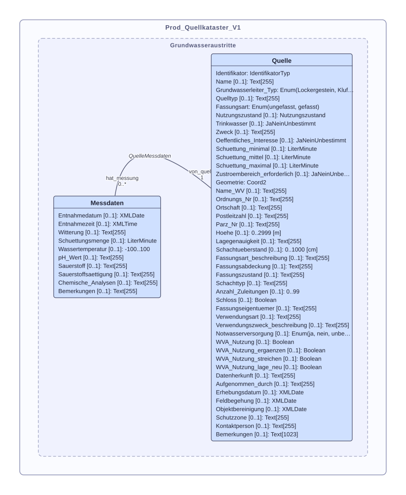

# prod_gl_quellkataster

Für die interne Haltung von Quellendaten wird ein neues Produktiv-Modell erstellt. Dieses basiert auf dem Objekt `Quelle` des MGDM-141.1 Grundwasseraustritte_V2_0, in welche die in `prod_gl_quellkataster` gehaltenen Objekte für Abgaben an den Bund exportiert werden sollen. 
Zusätzlich zu den Quellen-Objekten fügt das prod-Modell die weitere Klasse `Messdaten` hinzu.



[Volle Attributendokumentation](doc/Prod_Quellkataster_V1_Attributen.md)


## Initialbefüllung

Das Überführen der diversen bestehenden Datenquellen wurde in einem dbt-Prozess realisiert. Somit ist die Datenherkunft für die Initialversion Dokumentiert in Code in desse Repository:

https://github.com/ayomeer/aue_dbt/tree/main/src/dbt/dbt_quellkataster


<!-- TODO: Wenn GitLab bereit: Repo Link anpassen und Hosted Docs Link hinzufügen -->


## ToDo

Für nächste Schema Version:
- [ ] Foto-Attributen hinzufügen  
- [ ] `last_modified'-Feld hinzufügen (modellieren + generiertes trigger-setup)
- [ ] post-import sql: `rendering_args.json` definieren und post-script generieren
- [ ] post-import sql für Generierung von `Identifikator`-Werten:
    ```SQL
    DEFAULT 'GL_' || nextval('gl_seq')
    ``` 


- [ ] Schema neu importieren mit `--createMetaInfo`, damit Model Baker Projektgenerierung funktioniert -> scripts ordner 